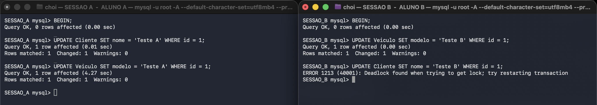

# Laboratório 01 – Parte 2
## Parte 3: Concorrência e Transações em Dupla

| | |
|---|---|
| **Disciplina** | Banco de Dados |
| **Banco de dados** | `Laboratorio1` |
| **SGBD** | MySQL 8.4.11 — engine InnoDB |
| **Data de execução** | 28/09/2026 |

**Ambiente:** duas janelas independentes do Terminal, lado a lado, cada uma com sua própria conexão ao MySQL — **Sessão A = Aluno A** (à esquerda) e **Sessão B = Aluno B** (à direita). Cada janela recebeu do servidor um *connection id* distinto, comprovando que se trata de sessões realmente concorrentes. Uma terceira sessão auxiliar foi usada apenas para inspecionar o dicionário de bloqueios, sem interferir nos experimentos.

---

# Experimento 3.1 — Bloqueio Explícito (`FOR UPDATE`)

Simulação de dois atendentes tentando reservar **o mesmo veículo** ao mesmo tempo.

## Comandos executados

| Passo | Sessão A (Aluno A) | Sessão B (Aluno B) |
|:-----:|--------------------|--------------------|
| 1 | `BEGIN;`<br>`SELECT * FROM Veiculo WHERE id = 1 FOR UPDATE;` | — |
| 2 | *(transação aberta, sem COMMIT)* | `BEGIN;`<br>`SELECT * FROM Veiculo WHERE id = 1 FOR UPDATE;` |
| 3 | `COMMIT;` | — |
| 4 | — | `COMMIT;` |

## Evidência 1 — a Sessão B ficou efetivamente bloqueada

Consulta executada por uma terceira sessão **enquanto** a Sessão B estava parada:

```
+------------------+-----------+----------------+--------------------+
| thread_bloqueada | estado    | segs_esperando | thread_bloqueadora |
+------------------+-----------+----------------+--------------------+
|               17 | LOCK WAIT |              4 |                 16 |
+------------------+-----------+----------------+--------------------+
```

A thread 17 (Sessão B) está no estado **`LOCK WAIT`**, aguardando há 4 segundos um recurso retido pela thread 16 (Sessão A).

## Evidência 2 — transcrição das duas sessões

```
--- SESSÃO A ---                          --- SESSÃO B ---
SESSAO_A mysql> BEGIN;                    SESSAO_B mysql> BEGIN;
Query OK, 0 rows affected (0.00 sec)      Query OK, 0 rows affected (0.00 sec)

SESSAO_A mysql> SELECT * FROM Veiculo     SESSAO_B mysql> SELECT * FROM Veiculo
                WHERE id = 1 FOR UPDATE;                  WHERE id = 1 FOR UPDATE;
+----+---------+---------+------------+   +----+---------+---------+------------+
| id | placa   | modelo  | status     |   | id | placa   | modelo  | status     |
+----+---------+---------+------------+   +----+---------+---------+------------+
|  1 | ABC1234 | Compass | disponivel |   |  1 | ABC1234 | Compass | disponivel |
+----+---------+---------+------------+   +----+---------+---------+------------+
1 row in set (0.00 sec)                   1 row in set (5.27 sec)   <<< ESPEROU
```

| Sessão | Comando | Tempo de resposta |
|--------|---------|-------------------|
| **A** | `SELECT ... FOR UPDATE` | **0.00 sec** — lock concedido de imediato |
| **B** | `SELECT ... FOR UPDATE` (idêntico) | **5.27 sec** — retida até o `COMMIT` de A |

O tempo de 5,27 s da Sessão B corresponde exatamente ao intervalo em que a Sessão A manteve a transação aberta. Assim que A executou `COMMIT`, a Sessão B foi liberada **imediatamente** e recebeu seu resultado.

## Conclusão

O `SELECT ... FOR UPDATE` adquire um **lock exclusivo (X) de registro** sobre a linha lida. Enquanto a transação detentora não encerra (`COMMIT` ou `ROLLBACK`), qualquer outra transação que tente obter o mesmo lock é **serializada** — fica em espera em vez de ler um dado prestes a mudar.

É esse o mecanismo que impede que dois atendentes reservem o mesmo veículo simultaneamente: o segundo só prossegue depois que o primeiro concluiu e, então, já enxerga o veículo como indisponível.

> Logs completos: `exp3.1_sessaoA.log` · `exp3.1_sessaoB.log`

---

# Experimento 3.2 — Indução de Deadlock

## Ordem de execução

| Passo | Sessão A (Aluno A) | Sessão B (Aluno B) |
|:-----:|--------------------|--------------------|
| 1 | `BEGIN;` | — |
| 2 | `UPDATE Cliente SET nome = 'Teste A' WHERE id = 1;` | — |
| 3 | — | `BEGIN;` |
| 4 | — | `UPDATE Veiculo SET modelo = 'Teste B' WHERE id = 1;` |
| 5 | `UPDATE Veiculo SET modelo = 'Teste A' WHERE id = 1;`<br>*(fica aguardando)* | — |
| 6 | — | `UPDATE Cliente SET nome = 'Teste B' WHERE id = 1;`<br>**→ DEADLOCK** |

## Registro prático — print da mensagem oficial do SGBD

No instante em que a Sessão B pede o lock de `Cliente`, o ciclo se fecha. A mensagem de erro aparece na janela da direita e, **simultaneamente**, a Sessão A é destravada e conclui seu `UPDATE` em `4.27 sec` — exatamente o tempo em que esteve esperando:



### Mensagem de erro (transcrita)

```
ERROR 1213 (40001): Deadlock found when trying to get lock; try restarting transaction
```

## Relatório do detector de deadlock (`SHOW ENGINE INNODB STATUS`)

```
LATEST DETECTED DEADLOCK
------------------------
2026-09-28 13:38:20

*** (1) TRANSACTION:
TRANSACTION 1666, ACTIVE 8 sec starting index read
MySQL thread id 19 ... UPDATE Veiculo SET modelo = 'Teste A' WHERE id = 1

*** (1) HOLDS THE LOCK(S):
RECORD LOCKS ... index PRIMARY of table `laboratorio1`.`cliente` lock_mode X

*** (1) WAITING FOR THIS LOCK TO BE GRANTED:
RECORD LOCKS ... index PRIMARY of table `laboratorio1`.`veiculo` lock_mode X waiting

*** (2) TRANSACTION:
TRANSACTION 1667, ACTIVE 5 sec starting index read
MySQL thread id 20 ... UPDATE Cliente SET nome = 'Teste B' WHERE id = 1

*** (2) HOLDS THE LOCK(S):
RECORD LOCKS ... index PRIMARY of table `laboratorio1`.`veiculo` lock_mode X

*** (2) WAITING FOR THIS LOCK TO BE GRANTED:
RECORD LOCKS ... index PRIMARY of table `laboratorio1`.`cliente` lock_mode X waiting

*** WE ROLL BACK TRANSACTION (2)
```

O relatório expõe o **ciclo de espera** com clareza:

- A transação **1666 (Sessão A)** detém o lock de `Cliente` e espera o de `Veiculo`;
- A transação **1667 (Sessão B)** detém o lock de `Veiculo` e espera o de `Cliente`.

Nenhuma pode avançar, pois cada uma aguarda um recurso que só seria liberado pela outra ao terminar — uma **espera circular**. O InnoDB detecta esse ciclo em seu grafo de espera (*wait-for graph*) e, em vez de deixar as sessões travadas indefinidamente, elege como vítima a transação de menor custo de desfazimento e a reverte: `WE ROLL BACK TRANSACTION (2)`. A Sessão A sobreviveu e concluiu normalmente.

## Explicação: como uma ordem padronizada de acesso evita o deadlock

O deadlock **não foi causado pelos dados nem pelo volume de acessos**, e sim pela **ordem divergente** em que as duas transações pediram os recursos:

| | 1º recurso | 2º recurso |
|---|---|---|
| **Sessão A** | `Cliente` | `Veiculo` |
| **Sessão B** | `Veiculo` | `Cliente` |

É justamente essa inversão que fecha o ciclo.

A prevenção consiste em estabelecer, como **convenção de toda a aplicação**, uma ordem global e única de acesso aos objetos — por exemplo, sempre em ordem alfabética:

```
Categoria → Cliente → Filial → Locacao → Veiculo
```

Se ambas as sessões respeitassem essa ordem, as duas bloqueariam `Cliente` **antes** de `Veiculo`. A segunda transação ficaria simplesmente em espera no primeiro recurso, sem jamais ter adquirido nada de que a primeira precisasse. Sem posse cruzada não há espera circular e, sem espera circular, **o deadlock é impossível** — quebra-se a quarta condição de Coffman, necessária para sua ocorrência. O resultado passa a ser um mero enfileiramento (*lock wait*), como no Experimento 3.1: mais lento, porém sempre correto e livre de abortos.

### Medidas complementares

- **Transações curtas:** manter o menor intervalo possível entre `BEGIN` e `COMMIT` reduz drasticamente a janela de colisão.
- **Índices adequados:** sem índice, o InnoDB varre e trava muito mais registros do que o necessário, ampliando a superfície de conflito. Todos os `UPDATE` deste experimento usaram a chave primária, travando apenas 1 linha cada.
- **Retry automático:** o deadlock é um erro esperado e transitório em sistemas concorrentes. A aplicação deve capturar o `SQLSTATE 40001` e **reexecutar a transação**, exatamente como sugere a própria mensagem do SGBD (*"try restarting transaction"*).

> Logs completos: `exp3.2_sessaoA.log` · `exp3.2_sessaoB.log` · `exp3.2_innodb_status.txt` *(relatório íntegro, com os registros em formato físico)*

---

# Experimento 3.3 — Níveis de Isolamento e MVCC

## Teste 1 — `READ COMMITTED`

| Passo | Sessão A | Sessão B (`READ COMMITTED`) | Valor lido por B |
|:-----:|----------|------------------------------|------------------|
| 1 | `BEGIN;`<br>`UPDATE Cliente SET nome='ALTERADO POR A' WHERE id=1;`<br>*(sem COMMIT)* | — | — |
| 2 | — | `BEGIN;`<br>`SELECT nome FROM Cliente WHERE id=1;` | **`João`** |
| 3 | `COMMIT;` | — | — |
| 4 | — | `SELECT nome FROM Cliente WHERE id=1;`<br>*(mesma transação)* | **`ALTERADO POR A`** |

```
SESSAO_B mysql> SELECT nome FROM Cliente WHERE id = 1;   -- 1a leitura
+----------------+
| nome           |
+----------------+
| João           |      <<< valor ANTIGO: leitura suja impedida
+----------------+

SESSAO_B mysql> SELECT nome FROM Cliente WHERE id = 1;   -- 2a leitura, mesma transação
+----------------+
| nome           |
+----------------+
| ALTERADO POR A |      <<< mudou: leitura NÃO REPETÍVEL
+----------------+
```

**Leitura Suja impedida (passo 2).** Embora a Sessão A já tivesse alterado a linha, a Sessão B continuou enxergando `João` — a **versão antiga**, reconstruída pelo MVCC a partir do *undo log*. Isso confirma que o InnoDB nunca expõe dados não confirmados: se A tivesse feito `ROLLBACK`, B jamais teria trabalhado com um valor que deixou de existir.

**Leitura Não Repetível constatada (passo 4).** A **mesma consulta**, dentro da **mesma transação**, devolveu resultado **diferente** após o `COMMIT` de A. É a limitação característica do nível `READ COMMITTED`: cada comando enxerga um snapshot novo, portanto não há estabilidade de leitura ao longo da transação.

## Teste 2 — `REPEATABLE READ`

| Passo | Sessão A | Sessão B (`REPEATABLE READ`) | Valor lido por B |
|:-----:|----------|-------------------------------|------------------|
| 1 | — | `BEGIN;`<br>`SELECT nome FROM Cliente WHERE id=1;`<br>*(cria o snapshot)* | **`ALTERADO POR A`** |
| 2 | `BEGIN;`<br>`UPDATE Cliente SET nome='COMMITADO POR A' WHERE id=1;`<br>`COMMIT;` | — | — |
| 3 | — | `SELECT nome FROM Cliente WHERE id=1;`<br>*(mesma transação)* | **`ALTERADO POR A`** ⬅ inalterado |
| 4 | — | `COMMIT;`<br>`SELECT nome FROM Cliente WHERE id=1;` | **`COMMITADO POR A`** |

```
SESSAO_B mysql> SELECT nome FROM Cliente WHERE id = 1;   -- cria o snapshot
| ALTERADO POR A  |

        (nesse meio-tempo a Sessão A executou UPDATE + COMMIT)

SESSAO_B mysql> SELECT nome FROM Cliente WHERE id = 1;   -- mesma transação
| ALTERADO POR A  |      <<< SNAPSHOT PRESERVADO

SESSAO_B mysql> COMMIT;
SESSAO_B mysql> SELECT nome FROM Cliente WHERE id = 1;   -- fora da transação
| COMMITADO POR A |      <<< novo snapshot
```

**Snapshot mantido.** Mesmo depois de a Sessão A ter **confirmado** sua alteração, a Sessão B continuou lendo `ALTERADO POR A` — o valor congelado no instante de sua primeira leitura. A leitura só passou a refletir `COMMITADO POR A` no passo 4, **após** o encerramento da transação de B, quando um novo snapshot foi criado.

## Conclusão sobre MVCC

O **MVCC** (*Multi-Version Concurrency Control*) permite que o InnoDB mantenha **várias versões do mesmo registro** simultaneamente, reconstruindo versões passadas a partir do *undo log*. Sua consequência prática mais importante é que **leituras não bloqueiam escritas e escritas não bloqueiam leituras**: em nenhum dos dois testes a Sessão B precisou esperar, apesar de a Sessão A estar alterando exatamente a linha consultada.

A diferença entre os níveis está apenas em **quando o snapshot é tirado**:

| Nível | Momento do snapshot | Comportamento observado |
|-------|---------------------|-------------------------|
| `READ COMMITTED` | a cada comando | Evita leitura suja, mas **permite leitura não repetível** |
| `REPEATABLE READ` | na primeira leitura da transação | Evita leitura suja **e** leitura não repetível — a transação inteira vê um estado consistente |

Para um relatório financeiro da locadora, que executa vários `SELECT` relacionados e precisa que todos reflitam o mesmo instante do banco, `REPEATABLE READ` é o nível apropriado. Já para uma consulta pontual de disponibilidade, que deve sempre mostrar o dado mais recente, `READ COMMITTED` é suficiente e gera menos retenção de versões antigas.

> Logs completos: `exp3.3_sessaoA.log` · `exp3.3_sessaoB.log`

---

# Integridade dos dados

Todos os experimentos foram encerrados com `ROLLBACK` ou com a restauração explícita dos valores. O banco `Laboratorio1` permanece com os dados originais importados:

```
+----+-------+----------------+     +----+---------+---------+------------+
| id | nome  | cpf            |     | id | placa   | modelo  | status     |
+----+-------+----------------+     +----+---------+---------+------------+
|  1 | João  | 111.222.333-44 |     |  1 | ABC1234 | Compass | disponivel |
+----+-------+----------------+     |  2 | XYZ9876 | Argo    | disponivel |
                                    +----+---------+---------+------------+
```

# Arquivos entregues

| Arquivo | Conteúdo |
|---------|----------|
| `script_parte3.sql` | Todos os comandos SQL da Parte 3, comentados e na ordem de execução |
| `print_3.2_b_DEADLOCK.png` | Print da mensagem de deadlock nas duas sessões |
| `exp3.1_sessaoA.log` / `exp3.1_sessaoB.log` | Transcrições do Experimento 3.1 |
| `exp3.2_sessaoA.log` / `exp3.2_sessaoB.log` | Transcrições do Experimento 3.2 |
| `exp3.2_innodb_status.txt` | Relatório íntegro do `SHOW ENGINE INNODB STATUS` |
| `exp3.3_sessaoA.log` / `exp3.3_sessaoB.log` | Transcrições do Experimento 3.3 |
